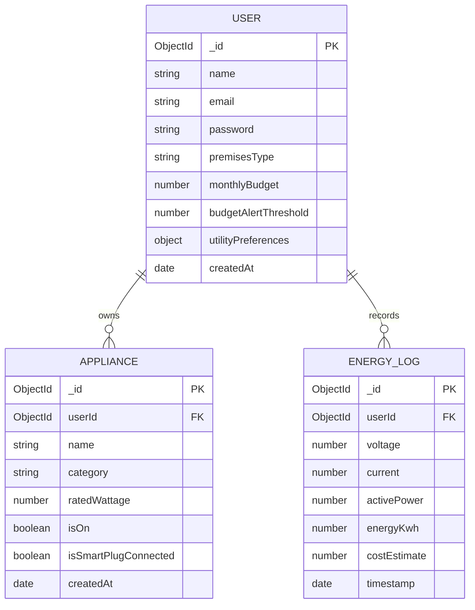

# SmartGrid Home - Household Energy Management Platform (SmartSurge)

> **EC4307 Web Application Development Mini Project**  
> **Official Project Title:** SmartGrid Home - Household Energy Management Platform  
> A full-stack MERN IoT Household Energy Management Platform built with React, Node.js, Express, MongoDB, and Socket.io real-time telemetry.

---

## Project Overview

**SmartGrid Home** (branded as **SmartSurge**) enables households to monitor live power consumption, automate appliance loads, prevent electrical peak-hour waste, and calculate electricity bills according to official **Sri Lankan CEB / LECO domestic tariff slabs**.

### Key Highlights:
- **Full CRUD Operations:** Add, monitor, toggle, edit, and delete smart household appliances.
- **Real-Time IoT Simulation & WebSockets:** Sub-second power telemetry streaming via `Socket.io`.
- **CEB / LECO Tariff Calculation Engine:** Accurately estimates progressive block tariffs, fixed charges, and fuel adjustments.
- **Demand-Side Management (DSM):** Automated peak-hour load shedding and phantom load protection.
- **Modern Responsive UI:** Designed with custom typography (`Reflow Sans` + `Gatilca`), interactive charts (`Recharts`), and seamless **Dark / Light mode switching**.

---

## System Architecture & Database Design (ERD)



---

## Tech Stack

- **Frontend:** React 19, Vite, Tailwind CSS v4, React Router v7, Lucide Icons, Recharts, Socket.io Client.
- **Backend:** Node.js, Express.js (REST API + WebSockets), Socket.io.
- **Security & Protection:** Helmet (HTTP Security Headers), Express-Rate-Limit (Brute-Force & DoS Protection), Express-Mongo-Sanitize (NoSQL Injection Prevention).
- **Database:** MongoDB with Mongoose ODM.
- **Authentication:** JWT (JSON Web Tokens) Bearer Authentication with Bcrypt password hashing & salt rounds.
- **Testing:** Node.js native test runner (`node --test`) for automated Unit Testing.

---

## API Endpoints Reference

All API routes are prefixed with `/api/v1` and protected via JWT Bearer authentication headers (except public Auth endpoints).

### 1. Authentication & User Profile (`/api/v1/auth`)
| Method | Endpoint | Access | Description |
| :--- | :--- | :--- | :--- |
| `POST` | `/api/v1/auth/register` | Public | Register a new user account with initial premises profile |
| `POST` | `/api/v1/auth/login` | Public | Authenticate user credentials and return JWT bearer token |
| `GET` | `/api/v1/auth/profile` | Private | Retrieve logged-in user profile, budget limits & preferences |
| `PUT` | `/api/v1/auth/profile` | Private | Update monthly budget, tariff tier preferences, and password |

### 2. Appliances Management - CRUD (`/api/v1/appliances`)
| Method | Endpoint | Access | Description |
| :--- | :--- | :--- | :--- |
| `GET` | `/api/v1/appliances` | Private | Retrieve all registered household appliances with filter/sort |
| `POST` | `/api/v1/appliances` | Private | Create a new appliance record with wattage & smart plug status |
| `PUT` | `/api/v1/appliances/:id` | Private | Update appliance details, edit wattage, or toggle state (ON/OFF) |
| `DELETE` | `/api/v1/appliances/:id` | Private | Safely remove an appliance and recalculate live load |

### 3. Energy Telemetry & Billing Analytics (`/api/v1/energy`)
| Method | Endpoint | Access | Description |
| :--- | :--- | :--- | :--- |
| `GET` | `/api/v1/energy/live` | Private | Get latest real-time telemetry snapshot (Watts, Volts, Amps) |
| `GET` | `/api/v1/energy/history` | Private | Query historical telemetry logs by timeframe (`day`, `week`, `month`) |
| `GET` | `/api/v1/energy/bill-estimate` | Private | Calculate progressive domestic CEB slab bill & breakdown |

### 4. Health & System Diagnostics
| Method | Endpoint | Access | Description |
| :--- | :--- | :--- | :--- |
| `GET` | `/api/v1/health` | Public | Verify server uptime, Socket.io gateway status, and timestamp |

### 5. WebSocket Real-Time Events (`Socket.io`)
| Event | Direction | Payload / Description |
| :--- | :--- | :--- |
| `connection` | Client -> Server | Establishes persistent real-time duplex socket connection |
| `energyUpdate` | Server -> Client | Broadcasts sub-second active power, voltage, and current stream |
| `applianceToggled` | Server -> Client | Notifies active clients when a smart relay is toggled ON/OFF |

---

## Getting Started & Installation

### Prerequisites
- [Node.js](https://nodejs.org/) (v18 or higher)
- [MongoDB](https://www.mongodb.com/try/download/community) installed and running locally on port `27017`

### 1. Clone the Repository
```bash
git clone https://github.com/your-username/smartsurge.git
cd smartsurge
```

### 2. Backend Setup
```bash
cd backend
npm install
```

Configure your environment variables in `backend/.env`:
```env
PORT=5000
MONGODB_URI=mongodb://127.0.0.1:27017/smartsurge
JWT_SECRET=smartsurge_super_secret_jwt_key_2026
JWT_EXPIRE=30d
```

Seed initial database records (Demo user & sample appliances):
```bash
npm run seed
```

Start the backend server:
```bash
npm run dev
# Server will run on http://localhost:5000
```

Run Automated Backend Unit Tests:
```bash
npm test
# Executes all test suites in tests/ folder (Auth, Appliances, Tariff slabs)
```

### 3. Frontend Setup
Open a new terminal:
```bash
cd frontend
npm install
npm run dev
# Frontend will run on http://localhost:5173
```

## Automated Unit Testing

The backend includes a dedicated unit testing suite under `backend/tests/` using Node.js's native test runner (`node --test`).

Run tests from the `backend/` directory:
```bash
npm test
```

### Test Suites Coverage:
- `tests/tariff.test.js`: Validates CEB Domestic progressive slab calculations (Tier 1: 0–30, Tier 2: 31–60, Tier 3: 61–90, Tier 4: 90+ kWh) and fixed charge thresholds.
- `tests/auth.test.js`: Tests Bcrypt salt generation, password hashing integrity, and JWT authentication token issuance & verification.
- `tests/appliance.test.js`: Tests Appliance entity schema constraints, field validations, and wattage ranges for CRUD integrity.

---

## Authentication & Test Credentials

You can create a new account through the `/register` page, or use the pre-configured credentials:
- **Email:** `demo@smartsurge.com`
- **Password:** `123456`

---

## Features Walkthrough

1. **Landing Page:** Interactive system overview, working live power simulator tabs, feature highlights, and CEB FAQ accordions.
2. **Smart Dashboard:** Live telemetry stream (Watts, Volts, Amps), estimated monthly bill prediction, and instant appliance quick-toggles.
3. **Appliances Management (CRUD):** Complete device inventory management with live power draw recalculation.
4. **Historical Energy Analytics:** Day/Week/Month telemetry visualization charts and log tables.
5. **Billing & CEB Tariff Reports:** Tiered progressive block breakdown (Block 1: 0–30, Block 2: 31–60, Block 3: 61–90 kWh).
6. **Energy Safeguards & Settings:** Voltage surge cutoff triggers, peak-hour load shedding, and monthly expenditure limits.

---

## License
This project is developed for educational evaluation under module **EC4307 - Web Application Development**. All rights reserved.
