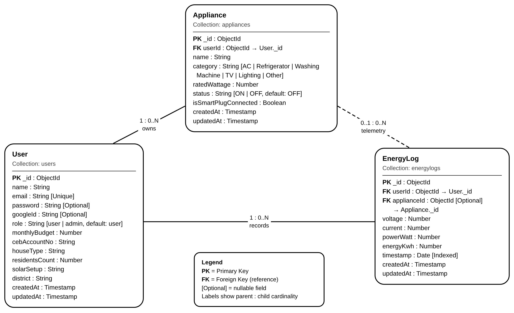
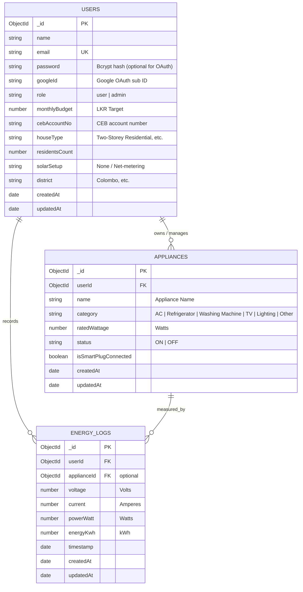

# SmartGrid Home - Household Energy Management Platform (SmartSurge)

> **EC4307: Web Application Development Project**  
> **Official Project Title:** SmartSurge: SmartGrid Home - Household Energy Management Platform  
> A production-ready, full-stack MERN IoT Household Energy Management Platform built with React 19, Node.js, Express, MongoDB Atlas, and Socket.io real-time telemetry.

---

## Live Deployments & API Documentation

- **Frontend Web Application:** [https://smartsurge-39pv.vercel.app](https://smartsurge-39pv.vercel.app)
- **Backend REST API:** [https://smartsurge.vercel.app](https://smartsurge.vercel.app)
- **API Health Check:** [https://smartsurge.vercel.app/api/v1/health](https://smartsurge.vercel.app/api/v1/health)
- **Comprehensive API Documentation:** [docs/API_DOCUMENTATION.md](docs/API_DOCUMENTATION.md)
- **Postman Collection:** [docs/SmartSurge.postman_collection.json](docs/SmartSurge.postman_collection.json) (Import directly into Postman)

---

## Core Platform Features

The SmartSurge platform incorporates a suite of 8 specialized household energy management modules highlighted on the interactive portal:

| Feature Icon | Feature Name | Capability & Description |
| :---: | :--- | :--- |
| **Smart Alerts** | Instant Spike & Limit Alerts | Sub-second notifications for over-voltage triggers (>250V), sudden power spikes (>3,500W), and budget limit warnings. |
| **AI Saving Tips** | Energy Optimization Advisory | Contextual heuristics and recommendations to curtail phantom loads and avoid high-tariff peak windows (18:30 - 22:30). |
| **Usage Analytics** | Live Power Breakdown | Real-time active wattage, mains voltage, and current streaming via WebSockets with dynamic appliance loads. |
| **Smart Scheduling** | Routine Switch Automation | Automated peak-hour load shedding and scheduled on/off appliance routines to eliminate idle power waste. |
| **Budget Goals** | Real-Time Target Tracking | Set monthly spending limits in LKR and monitor active budget consumption progress bars with automated overage alerts. |
| **Carbon Footprint** | Environmental Impact Metric | Quantifies household carbon emission savings and environmental efficiency based on electricity reduction. |
| **CEB Tariff Slabs** | Domestic PUCSL Estimation | Official progressive domestic block calculation (0–30, 31–60, 61–90, 90+ kWh) with accurate fixed service charge additions. |
| **Data & CSV Export** | One-Click Report Downloads | Direct export capabilities for historical telemetry logs and monthly billing breakdowns in CSV and document formats. |

---

## Detailed Platform Capabilities

### 1. Dual Authentication & Identity Management
- **Google OAuth 2.0 Integration:** Fast, one-click authentication via `@react-oauth/google` and verified server-side with `google-auth-library`.
- **Local Email & Password Authentication:** Secure registration and login powered by JSON Web Tokens (JWT) and `bcryptjs` password hashing with salt rounds.
- **Form UX & Security:**
  - Password visibility toggle (Show/Hide).
  - Clean single-line divider (`OR CONTINUE WITH`) separating local and Google auth options.
  - Automatic token persistence in `localStorage` and route protection via React Router guards.

### 2. Full Mobile & Cross-Device Responsiveness
- **Adaptive Layouts:** Tested across mobile screens (<640px), tablets (768px - 1024px), and high-resolution desktop viewports.
- **Mobile Drawer Navigation:**
  - Protected app interface includes a dedicated mobile header with brand identity and a slide-out drawer menu for effortless one-handed thumb navigation.
  - Automatic drawer close on route change and overlay backdrop dismiss.
- **Responsive Landing Header:**
  - Desktop pill navigation with quick action buttons.
  - Mobile hamburger toggle (`Menu` / `X`) with smooth animated slide-down accordion for navigation links and auth buttons.
- **Scroll & Card Adaptability:** Responsive flex wrapping, touch-scrollable tables, chart containers with auto-resizing SVG viewBoxes, and responsive modal dialogues.

### 3. High-Contrast Dark & Light Mode
- **Persistent Theme Engine:** Powered by custom React `ThemeContext` with state stored in `localStorage` and synchronized with system OS preferences (`prefers-color-scheme`).
- **Tailwind CSS v4 Dark Selector:** Complete palette switching between light canvas (`#F8FAF6`, `#FFFFFF`) and high-contrast dark tones (`#0F172A`, `#1E293B`, `#022c22`).
- **Floating & Header Theme Toggles:** Dedicated `ThemeToggle` component with Sun/Moon icons accessible on both landing and authenticated app navigation bars.

### 4. Smart Dashboard & Real-Time Telemetry Simulation
- **Live Duplex WebSockets (`Socket.io`):** Instant sub-second updates streaming live active wattage, mains voltage, and line current.
- **CEB Slab Progress Bar:** Visual indicator tracking current household consumption against CEB 30, 60, and 90 kWh thresholds.
- **Real-Time Visual Alerts (SurgeToast):** Custom toast notification trigger warning users when power surges exceed safety thresholds (e.g., >3,500W).
- **Quick Appliance Control:** Instant toggle switch widgets right from the dashboard to remotely switch connected smart plugs ON or OFF.
- **Dynamic Cost Projection:** Live-updating monthly expenditure predictions based on active telemetry.

### 5. Appliances Management (Complete CRUD)
- **Device Inventory:** View all household appliances categorized by AC, Refrigerator, Washing Machine, TV, Lighting, and Other.
- **Add New Appliance:** Modal form with rated wattage specification, category selection, and smart plug assignment.
- **Edit Appliance Details:** Modify appliance name, category, or power rating with immediate recalculation of total household connected load.
- **Delete Appliance:** Safe removal with confirmation modal to prevent accidental data loss.
- **Interactive State Toggling:** Remote relay state switching with live database synchronization and Socket.io event broadcasting.

### 6. CEB / LECO Domestic Tariff Billing Engine
- **Progressive Slab Calculation:** Models official Public Utilities Commission of Sri Lanka (PUCSL) domestic electricity tariff structures:
  - **Block 1 (0–30 kWh):** Lowest subsidized unit rate.
  - **Block 2 (31–60 kWh):** Intermediate domestic rate.
  - **Block 3 (61–90 kWh):** Progressive block rate.
  - **Block 4 (90+ kWh):** Higher consumption tier with stepped fixed monthly service charges.
- **Interactive Tariff Breakdown:** Visual cards showing exact unit charges, fixed monthly service fees, and total estimated billing amounts.
- **Billing History & Statements:** Comprehensive monthly breakdown with downloadable PDF / CSV export simulations.

### 7. Historical Analytics & Data Visualization
- **Multi-Period Filtering:** Switch views seamlessly between Daily, Weekly, and Monthly usage logs.
- **Interactive Recharts Visualizations:** Responsive Area charts, Bar charts, and Line graphs highlighting peak consumption hours.
- **Telemetry Log Table:** Tabular inspection of voltage, current, power draw, and timestamps with pagination and search.

### 8. Energy Safeguards & Smart Automation (DSM)
- **Overvoltage & Voltage Surge Cutoff:** Automatic load disconnect when grid voltage exceeds safety tolerances (e.g., 250V+).
- **Peak-Hour Load Shedding:** Schedules automated power restrictions during Sri Lanka's national peak window (18:30 - 22:30).
- **Monthly Budget Alerting:** Customizable budget threshold alerts notifying users when current month projections exceed budget limits (e.g., 80% or 100% of LKR target).

### 9. User Profile & Utility Preferences
- **Account Management:** Edit user profile, household type (Single-storey, Two-storey, Apartment), resident count, and geographical district.
- **Utility Account Binding:** Store CEB / LECO utility account number for bill cross-referencing.
- **Solar PV Net-Metering Settings:** Configuration options for households with rooftop solar net-accounting / net-metering systems.

### 10. Robust Backend Security & Reliability
- **HTTP Security Headers (`helmet`):** Protection against Cross-Site Scripting (XSS), clickjacking, and MIME-sniffing.
- **Rate Limiting (`express-rate-limit`):** Prevents DoS and brute-force attacks by limiting requests per IP window.
- **NoSQL Injection Sanitization (`express-mongo-sanitize`):** Prohibits MongoDB query selector injection attempts.
- **CORS Protection:** Configured with strict origin whitelisting allowing authorized frontend clients.
- **Mongoose Connection Caching:** Optimized serverless database connection pooling preventing connection leaks in Vercel functions.

---

## System Architecture & Database Design (ERD)



<details>
<summary>Click to view Mermaid Diagram definition</summary>



</details>

---

## Tech Stack

| Layer | Technologies |
| :--- | :--- |
| **Frontend Framework** | React 19, Vite 8, React Router v7 |
| **Styling & Icons** | Tailwind CSS v4, Lucide React Icons |
| **Charts & Visualization** | Recharts Responsive Area & Bar Charts |
| **Real-Time WebSockets** | Socket.io Client |
| **Third-Party Auth** | `@react-oauth/google`, `google-auth-library` |
| **Backend Runtime** | Node.js (v18+), Express.js (REST API + WebSockets) |
| **Database & ODM** | MongoDB Atlas Cloud, Mongoose 8 |
| **Security Packages** | Helmet, Express-Rate-Limit, Express-Mongo-Sanitize, Bcryptjs, JSONWebToken |
| **Cloud Hosting** | Vercel (Edge Network + Serverless Functions) |
| **Automated Testing** | Node.js Native Test Runner (`node --test`) |

---

## API Endpoints Reference

All API routes are prefixed with `/api/v1` and protected via JWT Bearer authentication headers (except public Auth and Health endpoints).

### 1. Authentication & Profile (`/api/v1/auth`)
| Method | Endpoint | Access | Description |
| :--- | :--- | :--- | :--- |
| `POST` | `/api/v1/auth/register` | Public | Register new user account with initial household profile |
| `POST` | `/api/v1/auth/login` | Public | Authenticate user credentials and return JWT bearer token |
| `POST` | `/api/v1/auth/google` | Public | Verify Google OAuth token, create or login user, return JWT |
| `GET` | `/api/v1/auth/profile` | Private | Retrieve logged-in user profile, budget limits & settings |
| `PUT` | `/api/v1/auth/profile` | Private | Update monthly budget, household profile, and settings |

### 2. Appliances Management - CRUD (`/api/v1/appliances`)
| Method | Endpoint | Access | Description |
| :--- | :--- | :--- | :--- |
| `GET` | `/api/v1/appliances` | Private | Retrieve all household appliances for authenticated user |
| `POST` | `/api/v1/appliances` | Private | Create a new appliance record with category and wattage |
| `PUT` | `/api/v1/appliances/:id` | Private | Update appliance details, edit wattage, or toggle status (ON/OFF) |
| `DELETE` | `/api/v1/appliances/:id` | Private | Delete appliance record and recalculate active household load |

### 3. Energy Telemetry & Billing Analytics (`/api/v1/energy`)
| Method | Endpoint | Access | Description |
| :--- | :--- | :--- | :--- |
| `GET` | `/api/v1/energy/live` | Private | Get latest real-time telemetry snapshot (Watts, Volts, Amps) |
| `GET` | `/api/v1/energy/history` | Private | Query historical telemetry logs by timeframe (`day`, `week`, `month`) |
| `GET` | `/api/v1/energy/bill-estimate` | Private | Calculate progressive domestic CEB slab bill & breakdown |

### 4. Health & System Diagnostics
| Method | Endpoint | Access | Description |
| :--- | :--- | :--- | :--- |
| `GET` | `/api/v1/health` | Public | Verify server uptime, API gateway status, and timestamp |

### 5. WebSocket Real-Time Events (`Socket.io`)
| Event | Direction | Payload / Description |
| :--- | :--- | :--- |
| `connection` | Client -> Server | Establishes persistent real-time duplex socket connection |
| `energyUpdate` | Server -> Client | Broadcasts sub-second active power, voltage, and current stream |
| `applianceToggled` | Server -> Client | Notifies active clients when a smart relay is toggled ON/OFF |

---

## Getting Started & Installation

### Prerequisites
- [Node.js](https://nodejs.org/) (v18 or higher)
- [MongoDB](https://www.mongodb.com/) (Local on port `27017` or MongoDB Atlas URI)

### 1. Clone the Repository
```bash
git clone https://github.com/dasunisenanayake25/smartsurge.git
cd smartsurge
```

### 2. Backend Setup
```bash
cd backend
npm install
```

Configure your environment variables in `backend/.env`:
```env
PORT=5000
MONGODB_URI=mongodb+srv://<username>:<password>@cluster0.nu4hyik.mongodb.net/smartsurge?retryWrites=true&w=majority
JWT_SECRET=your_super_secret_jwt_key
JWT_EXPIRE=30d
CLIENT_URL=http://localhost:5173
GOOGLE_CLIENT_ID=your_google_client_id.apps.googleusercontent.com
```

Seed initial database records (Demo user & sample appliances):
```bash
npm run seed
```

Start the backend server:
```bash
npm run dev
# Server runs on http://localhost:5000
```

Run Automated Backend Unit Tests:
```bash
npm test
# Executes all test suites in tests/ folder (Auth, Appliances, Tariff slabs)
```

### 3. Frontend Setup
Open a new terminal:
```bash
cd frontend
npm install
```

Configure your environment variables in `frontend/.env`:
```env
VITE_API_URL=http://localhost:5000/api/v1
VITE_SOCKET_URL=http://localhost:5000
VITE_GOOGLE_CLIENT_ID=your_google_client_id.apps.googleusercontent.com
```

Start the frontend development server:
```bash
npm run dev
# Frontend runs on http://localhost:5173
```

---

## Automated Unit Testing

The backend includes a dedicated unit testing suite under `backend/tests/` using Node.js's native test runner (`node --test`).

Run tests from the `backend/` directory:
```bash
npm test
```

### Test Suites Coverage:
- `tests/tariff.test.js`: Validates CEB Domestic progressive slab calculations (Tier 1: 0–30, Tier 2: 31–60, Tier 3: 61–90, Tier 4: 90+ kWh) and fixed charge thresholds.
- `tests/auth.test.js`: Tests Bcrypt salt generation, password hashing integrity, and JWT authentication token issuance & verification.
- `tests/appliance.test.js`: Tests Appliance entity schema constraints, field validations, and wattage ranges for CRUD integrity.

---

## Authentication & Test Credentials

You can sign in using **Continue with Google** or use the pre-configured credentials:
- **Email:** `demo@smartsurge.com`
- **Password:** `123456`

---

## License
This project is developed for educational evaluation under module **EC4307: Web Application Development**. All rights reserved.
