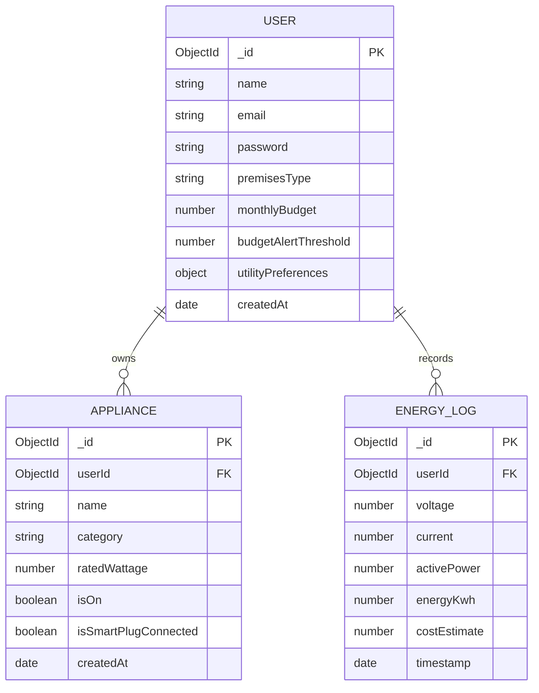

# SmartGrid Home - Household Energy Management Platform (SmartSurge)

> **EC4307 Web Application Development Mini Project**  
> **Official Project Title:** SmartGrid Home - Household Energy Management Platform  
> A full-stack MERN IoT Household Energy Management Platform built with React, Node.js, Express, MongoDB, and Socket.io real-time telemetry.

---

## Project Overview

**SmartGrid Home** (branded as **SmartSurge**) enables households to monitor live power consumption, automate appliance loads, prevent electrical peak-hour waste, and calculate electricity bills according to official **Sri Lankan CEB / LECO domestic tariff slabs**.

### Key Highlights:
- **Full CRUD Operations:** Add, monitor, toggle, edit, and delete smart household appliances.
- **Real-Time IoT Simulation & WebSockets:** Sub-second power telemetry streaming via `Socket.io`.
- **CEB / LECO Tariff Calculation Engine:** Accurately estimates progressive block tariffs, fixed charges, and fuel adjustments.
- **Demand-Side Management (DSM):** Automated peak-hour load shedding and phantom load protection.
- **Modern Responsive UI:** Designed with custom typography (`Reflow Sans` + `Gatilca`), interactive charts (`Recharts`), and seamless **Dark / Light mode switching**.

---

## System Architecture & Database Design (ERD)



---

## Tech Stack

- **Frontend:** React 19, Vite, Tailwind CSS v4, React Router v7, Lucide Icons, Recharts, Socket.io Client.
- **Backend:** Node.js, Express.js (REST API + WebSockets), Socket.io.
- **Database:** MongoDB with Mongoose ODM.
- **Authentication:** JWT (JSON Web Tokens) with secure HTTP headers & Bcrypt password encryption.

---

## Evaluation Criteria Mapping (EC4307 Rubric)

| Rubric Criterion | Implementation Details | Endpoints / Components |
| :--- | :--- | :--- |
| **Create (4 Marks)** | Add new smart appliances with validation (name, category, wattage, smart plug status). | `POST /api/appliances` <br/> `Appliances.jsx` |
| **Read (4 Marks)** | List, search, category filter, and view real-time status of all registered appliances. | `GET /api/appliances` <br/> `Appliances.jsx`, `Dashboard.jsx` |
| **Update (4 Marks)** | Real-time state toggling (ON/OFF), wattage editing, and threshold re-calibration. | `PUT /api/appliances/:id` <br/> `PUT /api/auth/profile` |
| **Delete (4 Marks)** | Safe appliance removal with instant dashboard telemetry re-calculation. | `DELETE /api/appliances/:id` <br/> `Appliances.jsx` |
| **Validation & Error Handling (2 Marks)** | Client-side reactive input validation + Server-side Mongoose schema & auth guards. | `authController.js`, `SurgeToast.jsx` |
| **Database Design (4 Marks)** | Normalized schemas (`User`, `Appliance`, `EnergyLog`) with relational keys & indexes. | `backend/models/` |
| **UI/UX & Responsiveness (2 Marks)** | Fully responsive layout (Mobile to Desktop), Dark/Light mode theme switch. | `ThemeToggle.jsx`, `index.css` |
| **Code Quality (2 Marks)** | MVC pattern, modular REST structure, zero linting errors, Git version control. | Clean modular architecture |

---

## Getting Started & Installation

### Prerequisites
- [Node.js](https://nodejs.org/) (v18 or higher)
- [MongoDB](https://www.mongodb.com/try/download/community) installed and running locally on port `27017`

### 1. Clone the Repository
```bash
git clone https://github.com/your-username/smartsurge.git
cd smartsurge
```

### 2. Backend Setup
```bash
cd backend
npm install
```

Configure your environment variables in `backend/.env`:
```env
PORT=5000
MONGODB_URI=mongodb://127.0.0.1:27017/smartsurge
JWT_SECRET=smartsurge_super_secret_jwt_key_2026
JWT_EXPIRE=30d
```

Seed initial database records (Demo user & sample appliances):
```bash
npm run seed
```

Start the backend server:
```bash
npm run dev
# Server will run on http://localhost:5000
```

Run Automated Backend Unit Tests:
```bash
npm test
# Executes all test suites in tests/ folder (Auth, Appliances, Tariff slabs)
```

### 3. Frontend Setup
Open a new terminal:
```bash
cd frontend
npm install
npm run dev
# Frontend will run on http://localhost:5173
```

---

## Authentication & Test Credentials

You can create a new account through the `/register` page, or use the pre-configured credentials:
- **Email:** `demo@smartsurge.com`
- **Password:** `123456`

---

## Features Walkthrough

1. **Landing Page:** Interactive system overview, working live power simulator tabs, feature highlights, and CEB FAQ accordions.
2. **Smart Dashboard:** Live telemetry stream (Watts, Volts, Amps), estimated monthly bill prediction, and instant appliance quick-toggles.
3. **Appliances Management (CRUD):** Complete device inventory management with live power draw recalculation.
4. **Historical Energy Analytics:** Day/Week/Month telemetry visualization charts and log tables.
5. **Billing & CEB Tariff Reports:** Tiered progressive block breakdown (Block 1: 0–30, Block 2: 31–60, Block 3: 61–90 kWh).
6. **Energy Safeguards & Settings:** Voltage surge cutoff triggers, peak-hour load shedding, and monthly expenditure limits.

---

## License
This project is developed for educational evaluation under module **EC4307 - Web Application Development**. All rights reserved.
